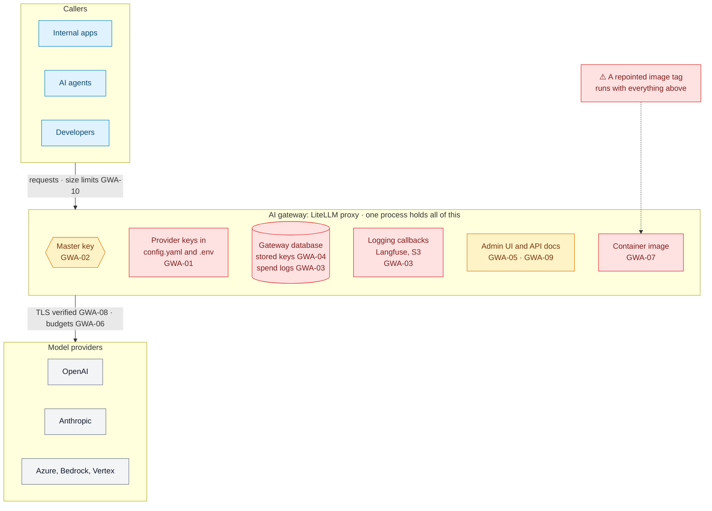
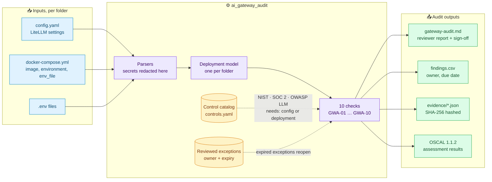

# ai-gateway-audit

**Audit your AI gateway like the tier-0 system it is.**

An AI gateway such as [LiteLLM](https://github.com/BerriAI/litellm) holds the API key for every model provider your company uses, and often every prompt and response that passes through it. On October 21, 2026, a compromised LiteLLM release shipped a payload that queried the gateway's credential tables directly ([analysis](https://mihirajmera.github.io/blog/the-ai-gateway-is-a-crown-jewel/)). Most teams still configure their gateway like a developer tool.

`ai-gateway-audit` reads a gateway's configuration and deployment files, checks them against ten controls, and produces evidence an auditor can use: a reviewer report, a findings sheet, hashed evidence files and OSCAL assessment results. Findings can be accepted only through a reviewed exception with an owner and an expiry date.

```bash
pip install git+https://github.com/Mihirajmera/ai-gateway-audit
ai-gateway-audit demo
```

```
DEPLOYMENT                    HIGH   MED   LOW   N/A
hardened                         0     0     0     0
insecure                         7     4     3     0
```

Read the [sample report](sample-output/gateway-audit.md) without installing anything.

## Why the gateway is tier-0

Every application and agent reaches every model through one process. That process holds the keys, sees the traffic and, often, stores both. Each box below is something an attacker who controls the gateway gets, and each label is the check that covers it.



## How it works



1. **Discover.** Every folder with a LiteLLM config or a Compose service running a LiteLLM image becomes one deployment. Compose `env_file:` references are followed.
2. **Redact.** Plain-text secrets are replaced with `[REDACTED]` while parsing, so nothing downstream ever holds them.
3. **Check.** Each check declares whether it needs the config or the deployment files. If the files it needs aren't there, it reports NOT ASSESSED.
4. **Apply exceptions.** A finding stays open unless a reviewed exception with an approver and an unexpired date covers it.
5. **Export.** A report for the reviewer, a CSV for tracking fixes, hashed evidence for the auditor and OSCAL for GRC tools.

## What it checks

| Check | Control | Typical failure |
|---|---|---|
| GWA-01 | Provider credentials are not stored in plain text | `api_key: sk-...` in `config.yaml`; a password in `DATABASE_URL` |
| GWA-02 | The proxy requires a master key that is not stored in plain text | no `master_key` at all, so the proxy is unauthenticated; or `master_key: sk-1234` |
| GWA-03 | Prompts and responses are kept out of logs | `store_prompts_in_spend_logs: true`; Langfuse or S3 callbacks without `turn_off_message_logging` |
| GWA-04 | Provider keys are not held in the gateway database | `store_model_in_db: true` with no key management system |
| GWA-05 | The admin UI does not accept a shared environment login | `UI_PASSWORD` in Compose; `disable_env_credential_login` not set |
| GWA-06 | Spend is capped globally and per key | no `max_budget`; keys can be minted without a budget |
| GWA-07 | The gateway image is pinned by digest | `litellm:main-stable`, one of the tags the October 2026 attacker repointed |
| GWA-08 | TLS certificates are verified on calls to providers | `ssl_verify: false` |
| GWA-09 | Interactive API documentation is disabled | `NO_DOCS` / `NO_REDOC` / `NO_OPENAPI` not set |
| GWA-10 | Request and upload sizes are limited | no `max_request_size_mb` or `allowed_file_extensions` |

Each check is mapped to NIST SP 800-53, SOC 2 and the OWASP Top 10 for LLM Applications in [`controls.yaml`](ai_gateway_audit/controls.yaml). The mappings are my judgment; check them against the official crosswalks before relying on them in an audit.

**What it can't see.** A configuration file can't prove that egress is restricted to model providers, that the admin UI isn't internet-facing, that keys are rotated, or that the database is encrypted. Every report lists these under *Needs evidence from outside the configuration*, so nobody mistakes a clean scan for a clean gateway.

**Not assessed is not passed.** If no Compose or `.env` file is found, the image and API-docs checks are reported as NOT ASSESSED, never as PASS.

## Scan your own gateway

Point it at the folder that holds your `config.yaml` and, ideally, the `docker-compose.yml` or `.env` that runs it:

```bash
ai-gateway-audit scan deploy/litellm --out audit
```

Files in the same folder are combined into one deployment. `env_file:` references in Compose are followed. Folders with no LiteLLM config or LiteLLM image are ignored, so you can scan a whole repository.

Outputs in `audit/`:

| File | For |
|---|---|
| `gateway-audit.md` | The reviewer: control results, every finding with a fix, and a sign-off block |
| `findings.csv` | Tracking remediation: one row per finding, with owner and due-date columns |
| `evidence/<deployment>.json` | The auditor: SHA-256 of every file read, the redacted settings, and a hash over both |
| `oscal/assessment-results.json` | GRC tooling: OSCAL 1.1.2, one finding per NIST 800-53 control |

### Reviewed exceptions

Some findings are acceptable for a reason. Record the decision instead of suppressing the check:

```yaml
# exceptions.yaml
exceptions:
  - check: GWA-09
    deployment: litellm          # or "*"
    setting: NO_DOCS             # optional
    decision: risk-accepted      # risk-accepted | not-applicable | deferred
    reason: Internal-only proxy behind the VPN; the platform team uses the docs.
    approved_by: Head of Platform
    expires: 2027-01-31
```

```bash
ai-gateway-audit scan deploy/litellm --exceptions exceptions.yaml
```

A covered finding shows as EXCEPTION with its approver and expiry. When the date passes, the exception stops applying, the finding reopens and the report lists it under *Expired exceptions*. Entries without a reason, approver or expiry date are rejected.

### In CI

```yaml
- run: pip install ai-gateway-audit
- run: ai-gateway-audit scan deploy/litellm --exceptions deploy/litellm/exceptions.yaml --fail-on medium
```

`--fail-on` exits 1 if any open finding is at or above that severity. `--format json` prints the results on stdout for other tools.

## Design

- **Secrets never reach the output.** Plain-text credentials are redacted while parsing, before anything is checked or written; findings name the setting, never the value. Tests check every output file for the example secrets.
- **Read-only, offline.** Files are parsed, never executed (`yaml.safe_load`), and the tool makes no network calls.
- **Reproducible evidence.** Set `SOURCE_DATE_EPOCH` and the same inputs produce byte-identical output, including deterministic OSCAL UUIDs.
- **Supply chain.** Hash-locked dependencies, actions pinned to commit SHAs, CodeQL, OpenSSF Scorecard, fuzzing with ClusterFuzzLite, and signed releases with SLSA level 3 provenance.

## Roadmap

- Kong AI Gateway (`ai-proxy` plugin) and Portkey configurations
- Kubernetes manifests and Helm values for the LiteLLM chart
- Reading settings stored in the LiteLLM database (when `store_model_in_db` is on), through the admin API

## Related

- [agent-access-review](https://github.com/Mihirajmera/agent-access-review): user access reviews for AI agents and MCP servers
- [llm-redteam-evidence](https://github.com/Mihirajmera/llm-redteam-evidence): turns red-team results into audit evidence with a release gate
- [The AI gateway is a crown jewel](https://mihirajmera.github.io/blog/the-ai-gateway-is-a-crown-jewel/): the incident analysis behind these checks

MIT licensed. Contributions welcome; see [CONTRIBUTING.md](CONTRIBUTING.md).
